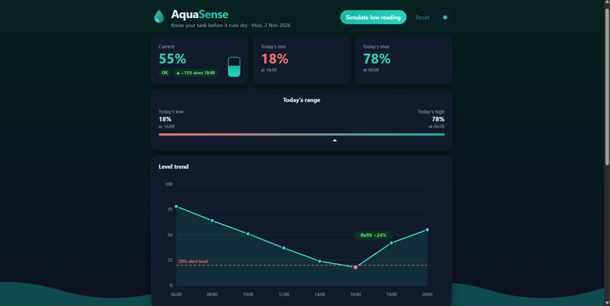
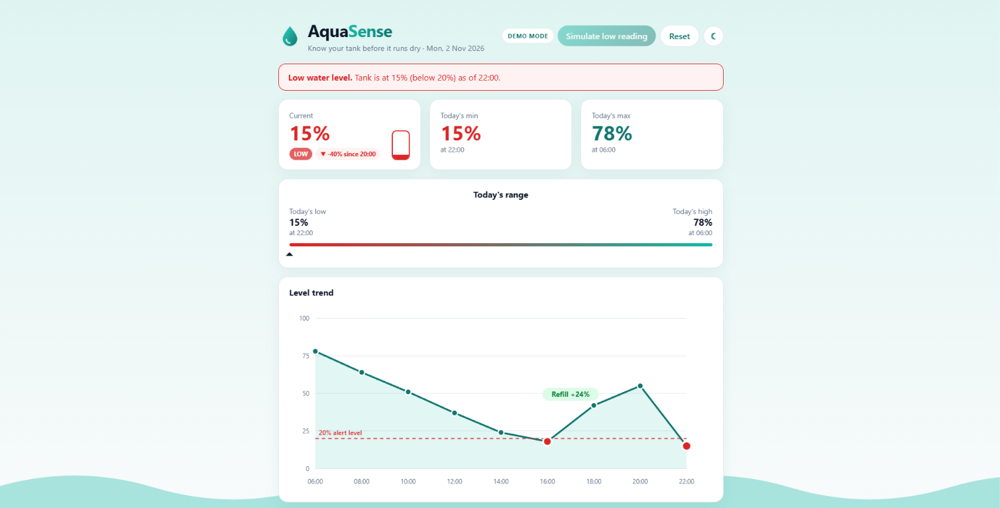
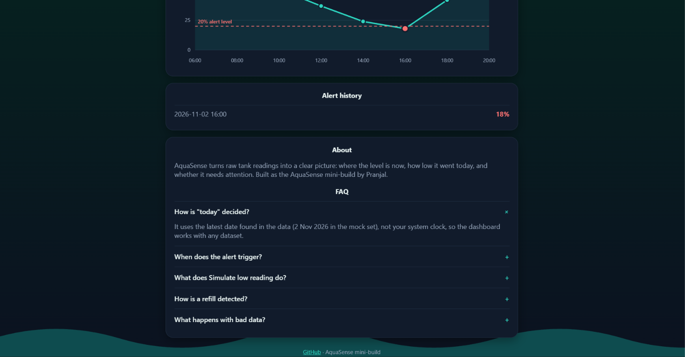
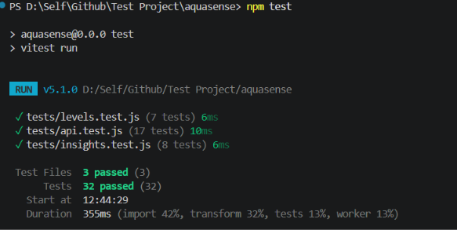

# AquaSense Mini-Build

**Live demo:** <vercel link>

A tank level dashboard (Part A) and a device API test suite (Part B), built for the Nivoryx Systems AquaSense assignment.

## Part A: Tank Level Dashboard

- Current level, today's min and max (with the time they happened), and a "Today's range" bar
- Status pill (OK / LOW) and a trend chip against the previous reading
- Red alert banner when the level is below 20%, plus an alert history list
- SVG chart with a dashed 20% line, hover tooltips, red points below 20% and a refill marker
- "Simulate low reading" button to demo the alert state, and a Reset button
- Light/dark mode, keyboard focus styles, `role="alert"` on the banner, reduced-motion support
- About and FAQ section

## Part B: API Testing

- **Test plan:** [docs/TEST_PLAN.md](docs/TEST_PLAN.md) (14 cases: positive, negative, edge). 12 are automated, 2 are left as manual.

- **Automation:** Vitest with mocked `fetch` responses in `tests/api.test.js`. The device API is hypothetical, so every response (200, 401, 404, malformed JSON, network failure) is simulated and no real network calls are made.
- **Wi-Fi loss paragraph:** [docs/WIFI_LOSS.md](docs/WIFI_LOSS.md)

## Run locally

    npm install
    npm run dev      # dashboard at http://localhost:5173
    npm test         # 32 tests
    npm run build    # production build

## Assumptions

- **"Today" is the latest date in the data** (2 Nov 2026 in the mock set), not the system date. The mock data is old, so using `new Date()` would give an empty dashboard.
- **Alert is strictly below 20%.** Exactly 20% is not an alert. Past dips stay visible in the alert history.
- **Invalid readings are dropped:** null, strings, values below 0 or above 100, and non-ISO timestamps. The rest are sorted by time.
- **Refill:** a rise of 15 points or more between two consecutive readings.
- **Stale device:** `last_seen` older than 5 minutes. **Anomaly:** level below 20% while the pump is off.
- The simulate button is a demo-only control. It adds a 15% reading two hours after the latest one and saves nothing.

## Decisions

- **Plain CSS instead of Tailwind.** For a one-page dashboard it keeps the code small, uses CSS variables for light/dark mode, and I can explain every line. My other project, BikeFixIt, uses Tailwind, so I am comfortable with it if the team prefers it.
- **Vitest instead of Jest.** The project is built on Vite, so Vitest reuses the same config and ESM setup with no extra Babel layer, and the suite runs in under a second. The API is Jest-compatible (`describe`, `it`, `expect`, `vi.fn`), so moving to Jest is a small change that I can make if required.
- **Logic is separate from UI.** `levels.js` and `insights.js` are pure functions, so they are tested directly without rendering anything.

## Project structure

    src/
      lib/levels.js        validation, sorting, min/max, alert logic
      lib/insights.js      trend, time of min/max, refill detection
      api/client.js        login and status client with response validation
      components/          StatCards, LevelChart, RangeBar, Faq
      data/readings.json   mock data
    tests/                 levels, insights and API tests
    docs/                  TEST_PLAN, WIFI_LOSS, AI_NOTE

## AI usage

See [docs/AI_NOTE.md](docs/AI_NOTE.md) for the tools used, two prompts, and what the AI got wrong.